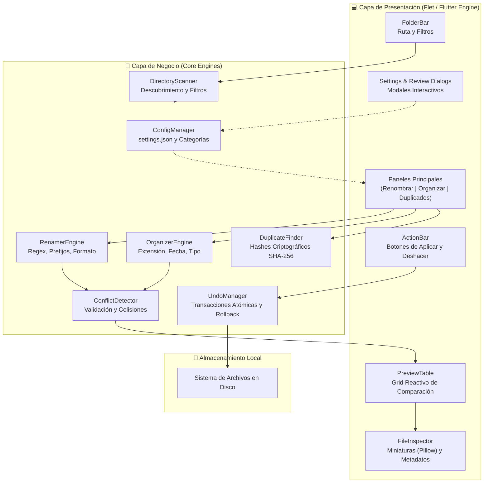

<div align="center">

  

  # FilesPy

  ### *Organizador, Renombrador por Lotes e Inspector Inteligente de Archivos*

  <p align="center">
    Una herramienta de escritorio moderna, ultrarrápida y segura construida con <b>Python</b> y <b>Flet (Flutter Engine)</b> con diseño en modo oscuro y acentos en <code>#f40048</code>.
  </p>

  <!-- Badges -->
  <p align="center">
    <a href="https://github.com/Mad065/FilesPy/releases">
      
    </a>
    <a href="https://www.python.org/">
      
    </a>
    <a href="https://flet.dev/">
      
    </a>
    <a href="#-instaladores-y-descargas">
      
    </a>
    <a href="LICENSE">
      
    </a>
  </p>

  <!-- Quick Links -->
  <p align="center">
    <a href="#-características-principales"><b>Explorar Funciones</b></a> •
    <a href="#-instaladores-y-descargas"><b>Descargar Binarios</b></a> •
    <a href="#-inicio-rápido"><b>Instalación Local</b></a> •
    <a href="#-guía-de-uso"><b>Guía de Uso</b></a> •
    <a href="#-arquitectura-del-sistema"><b>Arquitectura</b></a>
  </p>

</div>

---

> [!TIP]
> **Seguridad ante todo**: Ninguna operación modifica archivos físicos en disco sin tu confirmación previa. FilesPy detecta colisiones de nombre en tiempo real y permite revertir cualquier lote con un solo clic mediante su motor de transacciones atómicas.

---

## 📑 Tabla de Contenidos

- [✨ Descripción General](#-descripción-general)
- [⚡ Características Principales](#-características-principales)
  - [1. Renombrado por Lotes Potente](#1-renombrado-por-lotes-potente-batch-rename)
  - [2. Organización Inteligente en Carpetas](#2-organización-inteligente-en-carpetas)
  - [3. Previsualización y Detección de Colisiones](#3-previsualización-interactiva-y-prevención-de-colisiones)
  - [4. Inspector Integrado de Archivos](#4-inspector-multimedia-pillow--texto)
  - [5. Detección Criptográfica de Duplicados](#5-detección-criptográfica-de-duplicados-sha-256)
  - [6. Sistema de Deshacer Atómico](#6-sistema-de-deshacer-atómico-undo--rollback)
  - [7. Organización Manual y Nombrado Híbrido](#7-organización-manual-y-nombrado-híbrido)
  - [8. Configuración Dinámica y Filtros](#8-configuración-dinámica-persistente)
- [📥 Instaladores y Descargas](#-instaladores-y-descargas)
- [🚀 Inicio Rápido](#-inicio-rápido)
  - [Requisitos Previos](#requisitos-previos)
  - [Instalación Paso a Paso](#instalación-paso-a-paso)
- [📖 Guía de Uso](#-guía-de-uso)
- [🏗️ Arquitectura del Sistema](#-arquitectura-del-sistema)
- [📁 Estructura del Proyecto](#-estructura-del-proyecto)
- [🛠️ Compilación Local de Instaladores](#-compilación-local-de-instaladores)
- [🔄 CI/CD Automatizado](#-cicd-automatizado)
- [📄 Licencia](#-licencia)

---

## ✨ Descripción General

**FilesPy** es una solución de escritorio concebida para poner orden en el caos de archivos. Diseñada meticulosamente con un enfoque visual moderno en **modo oscuro**, ofrece la fluidez del motor Flutter a través de **Flet** junto con la potencia y flexibilidad de **Python 3**.

Resuelve de forma eficiente tres de las tareas más comunes y propensas a errores en cualquier sistema operativo:
1. **Renombrar** cientos de archivos aplicando reglas complejas (regex, numeración, capitalización).
2. **Organizar** estructuras caóticas clasificándolas por formato, categorías temáticas o fechas.
3. **Identificar y depurar** archivos duplicados mediante huellas hash SHA-256 sin importar su nombre.

---

## ⚡ Características Principales

<table>
  <tr>
    <td width="50%">
      <h3>🏷️ 1. Renombrado por Lotes Potente</h3>
      <ul>
        <li><b>Búsqueda y Reemplazo:</b> Coincidencia directa o patrones avanzados mediante <code>Regex</code> (con distinción opcional de mayúsculas).</li>
        <li><b>Prefijos y Sufijos:</b> Añade metadatos o etiquetas al inicio o final preservando la extensión original.</li>
        <li><b>Numeración Secuencial:</b> Genera correlativos automáticos (ej. <code>_001</code>, <code>_002</code>) con selector de inicio y dígitos de relleno.</li>
        <li><b>Normalización de Formato:</b> Alterna entre <code>minusculas</code>, <code>MAYÚSCULAS</code>, <code>Título</code>, <code>snake_case</code> y <code>kebab-case</code>.</li>
        <li><b>Control de Extensiones:</b> Mantén, estandariza o modifica extensiones en masa.</li>
      </ul>
    </td>
    <td width="50%">
      <h3>📂 2. Organización Inteligente en Carpetas</h3>
      <ul>
        <li><b>Por Extensión:</b> Clasifica automáticamente en subdirectorios temáticos (<code>PDF/</code>, <code>JPG/</code>, <code>DOCX/</code>).</li>
        <li><b>Por Categorías Dinámicas:</b> Agrupa por tipo de contenido (<i>Documentos, Imágenes, Audio, Video, Código, Comprimidos</i>), completamente personalizable.</li>
        <li><b>Cronología por Fechas:</b> Estructura carpetas por Año y Mes (<code>YYYY/MM</code>) leyendo metadatos reales de modificación en disco.</li>
        <li><b>Recursivo o Plano:</b> Procesa únicamente la carpeta actual o incluye subcarpetas con un clic.</li>
      </ul>
    </td>
  </tr>
  <tr>
    <td width="50%">
      <h3>🛡️ 3. Previsualización y Prevención de Colisiones</h3>
      <ul>
        <li><b>Grid Reactivo en Vivo:</b> Compara el nombre original, nuevo nombre propuesto, ruta de destino y tamaño en tiempo real.</li>
        <li><b>Detección Activa de Conflictos:</b> Identifica y bloquea la operación si dos archivos tendrían el mismo nombre o si ya existe uno en el destino.</li>
        <li><b>Control Granular:</b> Activa o desactiva elementos individualmente o selecciona todos mediante un interruptor maestro.</li>
      </ul>
    </td>
    <td width="50%">
      <h3>🔍 4. Inspector Multimedia (Pillow + Texto)</h3>
      <ul>
        <li><b>Miniaturas Fluidas:</b> Previsualización rápida de imágenes (<code>PNG</code>, <code>JPG</code>, <code>WEBP</code>, <code>GIF</code>, <code>BMP</code>, <code>SVG</code>).</li>
        <li><b>Lector de Código y Texto:</b> Muestra extractos de archivos planos, scripts y documentos sin abrir aplicaciones externas.</li>
        <li><b>Ficha Técnica:</b> Visualiza peso exacto formateado (KB, MB, GB), fecha y ruta absoluta.</li>
      </ul>
    </td>
  </tr>
  <tr>
    <td width="50%">
      <h3>🧬 5. Detección Criptográfica (SHA-256)</h3>
      <ul>
        <li><b>Análisis en 2 Fases:</b> Filtrado rápido por tamaño exacto en bytes seguido del cálculo SHA-256 en bloques de 64 KB para máximo rendimiento.</li>
        <li><b>Independiente del Nombre:</b> Detecta archivos con contenido idéntico aunque tengan nombres completamente distintos.</li>
        <li><b>Aislamiento Seguro:</b> Mueve duplicados redundantemente a un directorio especial (<code>_Duplicados</code>) para revisión segura.</li>
      </ul>
    </td>
    <td width="50%">
      <h3>⏪ 6. Sistema de Deshacer Atómico (Undo)</h3>
      <ul>
        <li><b>Transacciones Reversibles:</b> Cada lote aplicado genera un registro transaccional exacto en memoria y registro persistente.</li>
        <li><b>Rollback en 1 Clic:</b> Reviértelo todo inmediatamente; los archivos regresan a sus nombres y ubicaciones previas de forma segura.</li>
      </ul>
    </td>
  </tr>
  <tr>
    <td width="50%">
      <h3>🎯 7. Organización Manual y Nombrado Híbrido</h3>
      <ul>
        <li><b>Recorrido Asistido:</b> Revisa archivo por archivo con previsualización visual y decide su destino al instante.</li>
        <li><b>Carpetas al Vuelo:</b> Crea y selecciona carpetas personalizadas (<code>Facturas</code>, <code>Clientes</code>, etc.) con el botón <code>＋ Agregar Carpeta</code>.</li>
        <li><b>Nombrado Híbrido:</b> Escribe un nombre a medida o pulsa <code>⚡ Auto-nombrar</code> para aplicar las reglas activas.</li>
        <li><b>Auto-avance Veloz:</b> Pasa automáticamente al siguiente elemento al asignar destino para un flujo de trabajo ultra ágil.</li>
      </ul>
    </td>
    <td width="50%">
      <h3>⚙️ 8. Configuración Dinámica Persistente</h3>
      <ul>
        <li><b>Modal de Preferencias:</b> Añade nuevas extensiones y categorías (ej. <i>Modelado 3D</i> con <code>.blend, .obj</code>).</li>
        <li><b>Lista Negra de Omitidos:</b> Ignora archivos del sistema o dependencias (<code>.DS_Store</code>, <code>node_modules</code>, <code>Thumbs.db</code>).</li>
        <li><b>Almacenamiento Local:</b> Ajustes guardados automáticamente en <a href="settings.json"><code>settings.json</code></a> con opción de restablecer valores de fábrica.</li>
      </ul>
    </td>
  </tr>
</table>

---

## 📥 Instaladores y Descargas

FilesPy cuenta con paquetes autocontenidos para los principales sistemas operativos, listos para usar sin necesidad de instalar Python ni librerías adicionales:

| Sistema Operativo | Paquete / Formato | Arquitectura | Descripción | Enlace |
| :---: | :--- | :---: | :--- | :---: |
|  **Windows** | `FilesPy-Windows-Setup.exe`<br><sub>o versión portable `.zip`</sub> | `x64` | Asistente de instalación Inno Setup con accesos directos al Menú Inicio y Escritorio. | [**Descargar**](https://github.com/Mad065/FilesPy/releases) |
|  **macOS** | `FilesPy-macOS.dmg`<br><sub>o `.zip` portable</sub> | `Universal` / `x64` / `arm64` | Imagen de disco `.dmg` con ventana de instalación arrastrar-y-soltar a `/Applications`. | [**Descargar**](https://github.com/Mad065/FilesPy/releases) |
|  **Linux** | `FilesPy-Linux-x64.tar.gz` | `x64` | Paquete portable con lanzador `install.sh` y acceso de escritorio `.desktop`. | [**Descargar**](https://github.com/Mad065/FilesPy/releases) |

> [!NOTE]
> Accede al historial completo de versiones y notas de versión en [**GitHub Releases**](https://github.com/Mad065/FilesPy/releases).

---

## 🚀 Inicio Rápido

Si prefieres ejecutar FilesPy directamente desde el código fuente o contribuir al proyecto:

### Requisitos Previos
- **Python 3.10+** instalado en tu sistema.
- Gestor de paquetes `pip` y soporte para entornos virtuales (`venv`).

### Instalación Paso a Paso

#### 1. Clonar el Repositorio
```bash
git clone https://github.com/Mad065/FilesPy.git
cd FilesPy
```

#### 2. Crear y Activar el Entorno Virtual
````carousel
<!-- slide -->
##### En macOS / Linux
```bash
python3 -m venv .venv
source .venv/bin/activate
```
<!-- slide -->
##### En Windows (PowerShell / CMD)
```cmd
python -m venv .venv
.venv\Scripts\activate
```
````

#### 3. Instalar Dependencias
```bash
pip install -r requirements.txt
```

#### 4. Lanzar la Aplicación
```bash
python main.py
```

---

## 📖 Guía de Uso

El flujo de trabajo en FilesPy está pensado para ser visual, rápido e intuitivo:

```text
[ 1. Explorar Carpeta ] ──▶ [ 2. Configurar Reglas ] ──▶ [ 3. Verificar en Vivo ] ──▶ [ 4. Aplicar Cambios ]
                                                                                               │
                                                                                    (¿Necesitas volver atrás?)
                                                                                               ▼
                                                                                     [ 5. Botón Deshacer ]
```

1. **📁 Cargar Directorio**:
   Haz clic en `Explorar...` y selecciona la carpeta a procesar. Activa la casilla `Subcarpetas` si deseas escanear recursivamente.
2. **⚙️ Seleccionar Modo de Operación**:
   - **Pestaña Renombrar**: Configura prefijos, sufijos, reemplazo de caracteres, numeración o formato de mayúsculas/minúsculas.
   - **Pestaña Organizar**: Elige si deseas ordenar por extensión, categoría o fecha (año/mes).
   - **Pestaña Duplicados**: Ejecuta el escaneo por hash SHA-256 para detectar copias redundantes y aislarlas.
3. **👀 Comprobación Visual**:
   Revisa la tabla central interactiva. Las filas se colorean dinámicamente:
   - 🟢 **Verde**: Operación lista y válida sin conflictos.
   - 🔴 **Rojo**: Alerta de colisión (el archivo ya existe en destino o dos archivos recibirían el mismo nombre).
4. **🖼️ Inspección de Detalles**:
   Toca cualquier archivo en la tabla para ver su miniatura (en imágenes) o extracto de texto en el panel lateral derecho.
5. **🚀 Aplicar Operaciones**:
   Pulsa en `Aplicar Cambios` para ejecutar las acciones en el disco de forma segura.
6. **↩️ Reversión Inmediata**:
   ¿Cambio inesperado o error involuntario? Presiona el botón `Deshacer` y todos los archivos volverán exactamente a su estado y ubicación anterior.

---

## 🏗️ Arquitectura del Sistema

FilesPy sigue una arquitectura desacoplada y reactiva en tres capas bien diferenciadas:



---

## 📁 Estructura del Proyecto

```text
FilesPy/
├── main.py                      # Punto de entrada de la aplicación
├── requirements.txt             # Dependencias del proyecto (flet, pillow)
├── settings.json                # Configuración persistente del usuario
├── .gitignore                   # Exclusiones de Git
├── README.md                    # Documentación principal
├── assets/                      # Recursos visuales y gráficos
│   └── icons/                   # Iconos vectoriales y ejecutables (.ico, .icns, .png)
├── core/                        # Módulos de lógica de negocio y motores
│   ├── config_manager.py        # Gestión y persistencia de configuración JSON
│   ├── conflicts.py             # Detección de colisiones y validación de rutas
│   ├── duplicates.py            # Localización de duplicados por hash SHA-256
│   ├── models.py                # Modelos de datos (dataclasses tipados)
│   ├── organizer.py             # Clasificación por extensión, categoría o fecha
│   ├── renamer.py               # Motor de transformaciones de nombres
│   ├── scanner.py               # Explorador de directorios con filtros
│   └── undo.py                  # Pila de transacciones y operaciones reversibles
├── ui/                          # Capa visual moderna (Flet)
│   ├── app.py                   # Ventana principal y pipeline reactivo
│   ├── theme.py                 # Constantes de diseño, paleta y formateadores
│   └── components/              # Componentes visuales desacoplados
│       ├── action_bar.py        # Barra de botones de acción (Aplicar, Deshacer)
│       ├── duplicate_panel.py   # Panel de análisis y aislamiento de duplicados
│       ├── folder_bar.py        # Barra de ruta, subcarpetas y configuración
│       ├── inspector_panel.py   # Panel lateral de miniaturas y metadatos
│       ├── manual_organize_dialog.py # Diálogo de clasificación y nombrado híbrido
│       ├── organize_panel.py    # Formulario de modos de organización
│       ├── preview_table.py     # Tabla interactiva con verificación visual
│       ├── rename_panel.py      # Formulario de reglas de renombrado
│       ├── settings_dialog.py   # Modal de edición de categorías y preferencias
│       └── step_review_dialog.py# Revisión paso a paso interactiva
├── packaging/                   # Empaquetado multiplataforma
│   ├── FilesPy.spec             # Especificación PyInstaller
│   ├── FilesPy.desktop          # Lanzador para entornos de escritorio Linux
│   ├── inno_setup.iss           # Script de instalación para Windows (Inno Setup)
│   └── icon_generator.py        # Generador de iconos .ico / .icns / .png
└── scripts/                     # Scripts de compilación automatizada
    ├── build_macos.sh           # Generador de .app y .dmg para macOS
    ├── build_windows.bat        # Generador de .exe y Setup para Windows
    └── build_linux.sh           # Generador de .tar.gz y .desktop para Linux
```

---

## 🛠️ Compilación Local de Instaladores

Si deseas compilar los binarios e instaladores de forma manual en tu máquina:

```bash
# 🍏 En macOS:
chmod +x scripts/build_macos.sh && ./scripts/build_macos.sh
# Salida: dist/FilesPy.app, installer_output/FilesPy-macOS.dmg y .zip

# 🪟 En Windows:
scripts\build_windows.bat
# Salida: dist\FilesPy\FilesPy.exe, installer_output\FilesPy-Windows-Setup.exe y .zip

# 🐧 En Linux:
chmod +x scripts/build_linux.sh && ./scripts/build_linux.sh
# Salida: installer_output/FilesPy-Linux-x64.tar.gz con script install.sh
```

---

## 🔄 CI/CD Automatizado

FilesPy cuenta con un pipeline de integración y despliegue continuo mediante **GitHub Actions** (`.github/workflows/build-installers.yml`):
- 🏷️ **Disparo Automático**: Se activa ante cualquier nueva etiqueta de versión (`v*`) o mediante ejecución manual (`workflow_dispatch`).
- ⚡ **Compilación Concurrente**: Construye los instaladores simultáneamente en runners nativos de Windows, macOS y Linux.
- 📦 **Publicación en Releases**: Empaqueta los binarios e instaladores y los adjunta automáticamente a la sección de lanzamientos de GitHub.

---

## 📄 Licencia

Este proyecto está distribuido bajo la licencia **MIT**. Para más detalles, consulta el archivo [LICENSE](LICENSE).

<div align="center">
  <sub>Desarrollado con ❤️ para simplificar la gestión masiva de archivos.</sub>
  <br>
  <a href="#filespy">⬆ Volver al inicio</a>
</div>
